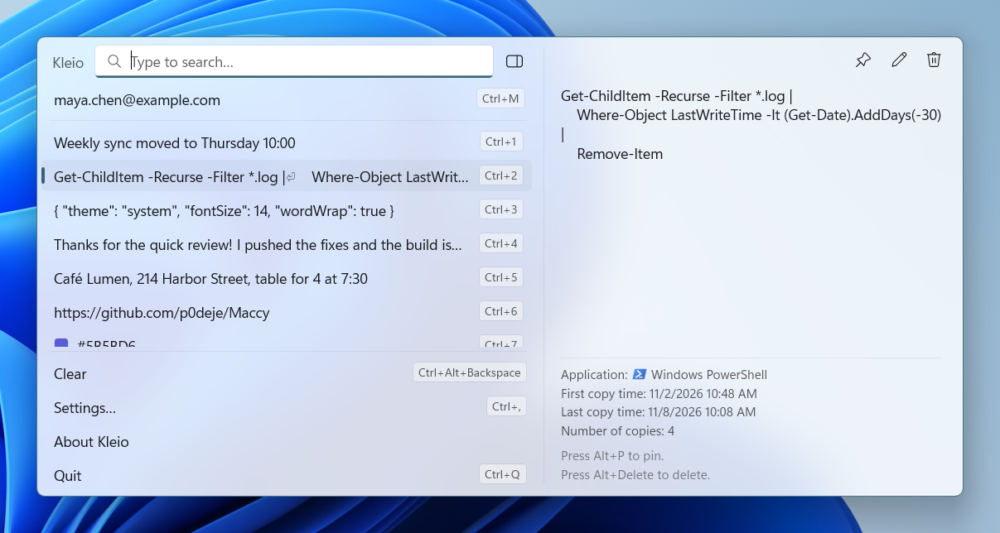
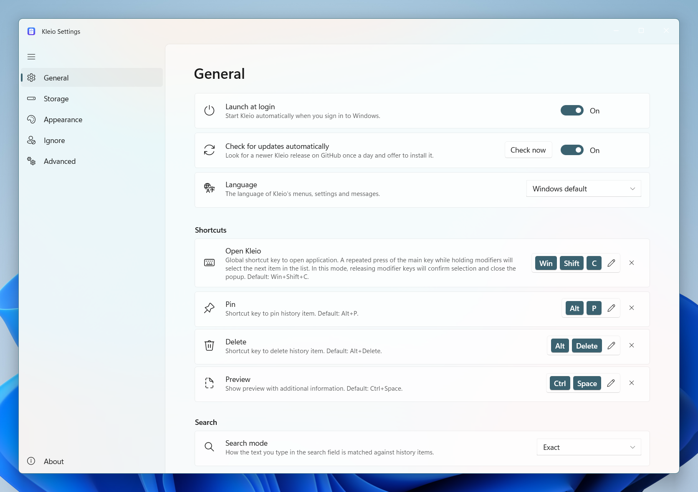

<h1>
  
  &nbsp;Kleio
</h1>


[](LICENSE)

Kleio is a lightweight clipboard manager for Windows 11. It keeps the history of what you copy and lets you quickly navigate, search, and use previous clipboard contents.

Kleio is a port of [Maccy](https://github.com/p0deje/Maccy) by [Alex Rodionov](https://github.com/p0deje) to Windows. It keeps Maccy's layout, behaviour and keyboard-first workflow. The only deliberate changes adopt Windows conventions: Fluent design, a notification-area icon instead of a menu bar item, and Windows key bindings. Built with WinUI 3 (Windows App SDK 2.5), C++/WinRT and MSIX packaging.

<picture>
  <source media="(prefers-color-scheme: dark)" srcset="docs/images/kleio-dark.png">
  
</picture>

## Features

- 🚀 **Lightweight and fast** — native C++, event-driven clipboard monitoring, SQLite storage
- ⌨️ **Keyboard-first** — open, search, copy, paste and navigate without touching the mouse
- 🔒 **Secure and private** — history never leaves your PC; honours the clipboard formats password managers use to hide entries
- 🎨 **Native Windows 11 UI** — Acrylic popup, Mica settings, light and dark theme, Segoe Fluent icons
- 🔍 **Search** — exact, fuzzy, regular expression, or mixed
- 📌 **Pins, preview, paste stack, editor** — pin items to the top, preview full content, paste a sequence, edit entries, OCR titles for images
- 💻 **Command line** — `kleio --get`, `--select`, `--delete`, `--clear` for scripting
- 🔄 **Auto-updates** — checks GitHub releases once a day
- 🌍 **43 languages** — the same translations as Maccy
- 📖 **Open source and free** — [MIT](LICENSE)

<details>
<summary>Settings</summary>



</details>

## Get started

### Requirements

Windows 10 version 2004 (build 19041) or later. Kleio is designed for Windows 11; on Windows 10 the popup and Settings use the Windows 10 fallbacks (no Mica or rounded corners, Segoe MDL2 icons).

### Install

Download the `.msix` for your architecture (x64 or ARM64) from the
[releases](https://github.com/Marshall2HD/kleio/releases/latest) page and open it.

#### CI builds

Development builds from CI (the `Kleio-x64` / `Kleio-ARM64` artifacts of the *Build* workflow) are
signed with a throw-away test certificate and ship the runtime packages they depend on (Windows App
SDK runtime and the VC++ runtime for desktop apps).
Trust the bundled `Kleio.cer` first (once, from an elevated PowerShell), then install:

```powershell
Import-Certificate -FilePath .\Kleio.cer -CertStoreLocation Cert:\LocalMachine\TrustedPeople
$packages = Get-ChildItem -Recurse -Include *.msix, *.appx
$packages | Where-Object DirectoryName -like '*Dependencies*' | ForEach-Object { Add-AppxPackage $_.FullName }
$packages | Where-Object Name -like 'Kleio_*' | ForEach-Object { Add-AppxPackage $_.FullName }
```

### First use

1. Press <kbd>Win</kbd> + <kbd>Shift</kbd> + <kbd>C</kbd> to open Kleio, or click its icon in the notification area.
2. Type to search your clipboard history.
3. Press <kbd>Enter</kbd> to copy the selected item, or <kbd>Alt</kbd> + <kbd>Enter</kbd> to copy and paste it.

To make <kbd>Win</kbd> + <kbd>V</kbd> open Kleio instead of Windows clipboard history, enable **Replace Win+V** in *Settings → General*.

## Documentation

- [Usage guide](docs/usage.md) — keyboard shortcuts, paste stack, preview, Windows clipboard integration, command line, ignore rules
- [Translations](docs/translations.md) — supported languages and how to contribute a translation
- [Build from source](docs/building.md) — requirements and build instructions
- [Architecture](docs/ARCHITECTURE.md) — how the code is organised
- [FAQ](docs/faq.md) — common questions and answers

## License

[MIT](LICENSE). Kleio is a port of [Maccy](https://github.com/p0deje/Maccy) by Alex Rodionov, also
MIT-licensed. See [THIRD_PARTY_NOTICES.md](THIRD_PARTY_NOTICES.md).
